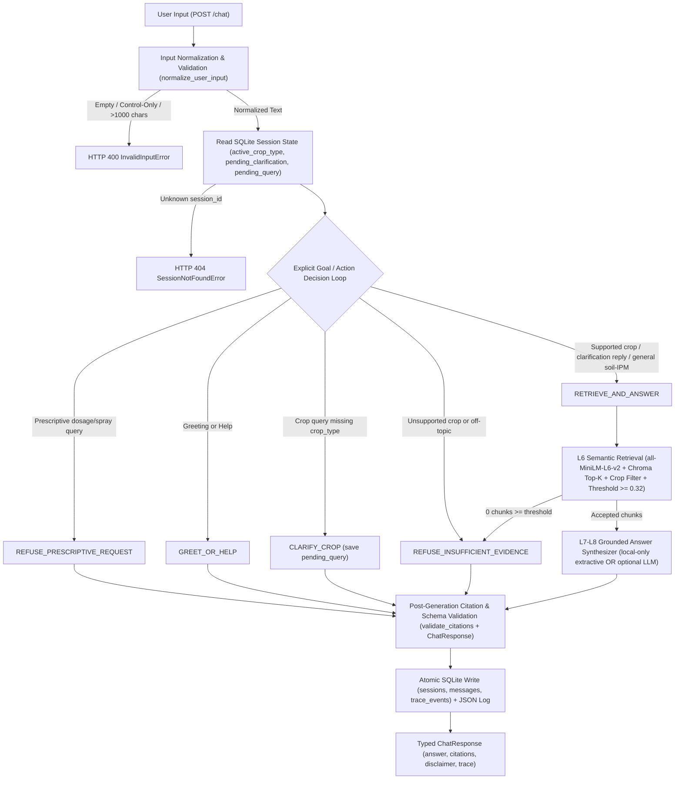

# System Architecture — P35: Agricultural Knowledge Navigator

## 1. End-to-End Request & Decision Flow (L1–L3, L6, L7–L8)



## 2. Component & Conversation-State Data Flow

```mermaid
flowchart LR
    Client["Evaluator / Client / Script"] -->|REST JSON| API["api.py (FastAPI Endpoints)"]
    API -->|read/create| REPO["repository.py (SQLiteRepository)"]
    API -->|handle_turn| ORCH["orchestrator.py (AgriNavigatorOrchestrator)"]

    ORCH -->|1. READ: active_crop, pending_clarification, pending_query, history| REPO
    ORCH -->|2. L6 search(query, crop_filter)| RET["retrieval.py (SemanticRetriever)"]
    RET -->|load & chunk on init| RAW["data/raw/*.md (6 Permitted Educational Docs)"]
    RET <-->|cosine query / persistent vectors| CHROMA["data/processed/chroma_db (ChromaDB)"]

    ORCH -->|3. L7-L8 synthesize(query, chunks)| RAG["grounded_answer.py (GroundedAnswerSynthesizer)"]
    RAG -.->|optional when configured| EXT["Optional OpenAI / Ollama (fallback on unavailable)"]

    ORCH -->|4. UPDATE: active_crop, pending_clarification, messages, TurnTrace| REPO
    REPO <-->|parameterized SQL transactions| SQLITE["data/processed/agri_navigator.db (SQLite)"]
```

## 3. Component Interfaces & Responsibilities

| Component | File | Inputs | Outputs | Responsibility |
|---|---|---|---|---|
| API Layer | `src/agri_navigator/api.py` | HTTP JSON (`ChatRequest`, `session_id`) | `HealthResponse`, `SessionCreateResponse`, `SessionDetailResponse`, `ChatResponse`, `list[TurnTrace]` | Request routing, dependency container wiring, HTTP 400/404 mapping, OpenAPI `/docs`. |
| Orchestrator (L1–L3) | `src/agri_navigator/orchestrator.py` | `session_id`, `raw_message`, `llm_mode_override` | `ChatResponse` + `TurnTrace` | Input normalization, safety/prescriptive screening, explicit goal/action loop, multi-turn clarification continuity, JSON logging. |
| Repository | `src/agri_navigator/repository.py` | `session_id`, turn updates, `TurnTrace` | `SessionState`, `SessionDetailResponse`, `list[TurnTrace]` | Transactional parameterized SQLite persistence for `sessions`, `messages` (bounded), and `trace_events`. |
| Semantic Retriever (L6) | `src/agri_navigator/retrieval.py` | `query`, `crop_filter`, `top_k`, `min_similarity` | `(list[RetrievedChunk], list[RetrievalCandidate])` | Deterministic frontmatter + heading chunking (`DOC-ID#sec-N`), `all-MiniLM-L6-v2` embeddings, Chroma cosine query, thresholding. |
| Grounded Synthesizer (L7–L8) | `src/agri_navigator/grounded_answer.py` | `query`, `crop_label`, accepted `RetrievedChunk`s | `GroundedAnswerResult` | Evidence-only answer composition, `[DOC-ID#sec-N]` inline citations, post-generation `validate_citations`, non-prescriptive disclaimer, safe optional-LLM fallback. |
| Domain Taxonomy | `src/agri_navigator/domain_data.py` | Normalized text | Crop alias, unsupported crop, prescriptive/greeting/agri flags | Deterministic domain guardrails and crop vocabulary mapping (`wheat`, `rice`, `tomato`, `maize`, `potato`, `general`). |

## 4. State Read & Update Points
1. **Session Creation (`POST /sessions`):** Inserts a row in `sessions` with `active_crop_type = NULL`, `pending_clarification = 0`, `pending_query = NULL`, `turn_count = 0`.
2. **Pre-Decision Read (`orchestrator.handle_turn`):** Reads `SessionState` and bounded `get_recent_messages` (up to `2 * max_history_turns` rows) before selecting an action.
3. **Clarification Pending Write (`CLARIFY_CROP`):** Sets `pending_clarification = 1` and stores the user's normalized question in `pending_query` so the next turn retains the original symptom.
4. **Clarification Resolution & Follow-Up (`RETRIEVE_AND_ANSWER`):** Reads `pending_query` + newly supplied crop (or inherits `active_crop_type` on follow-ups), clears `pending_clarification = 0` and `pending_query = NULL`, updates `active_crop_type`, appends both messages, and writes `TurnTrace` atomically inside one SQLite transaction.

## 5. Latency, Reliability, and Cost Trade-Offs
- **Latency:** Model weights (`all-MiniLM-L6-v2`, 384-dim) are loaded once at app startup (`AppContainer`); per-turn retrieval + local extractive synthesis executes in ~10–150 ms locally after warm-up, avoiding external network round-trips.
- **Reliability:** `local-only` mode is deterministic and works offline once the model is cached. If optional `openai` or `ollama` mode is selected while unconfigured/unreachable, `ProviderUnavailableError` is caught, recorded in `TurnTrace.error_class`, and safely falls back to `local-only` grounded synthesis.
- **Cost:** Zero API token cost in default `local-only` mode. Storage footprint is lightweight (~24 indexed educational chunks in Chroma + compact SQLite database).
